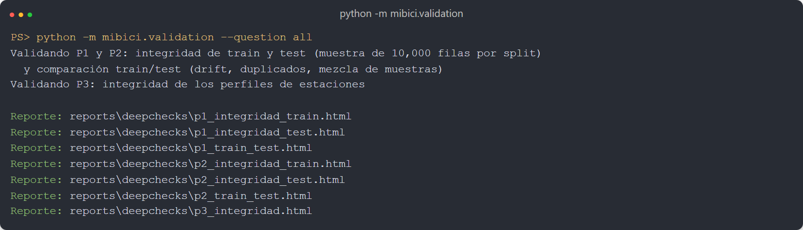
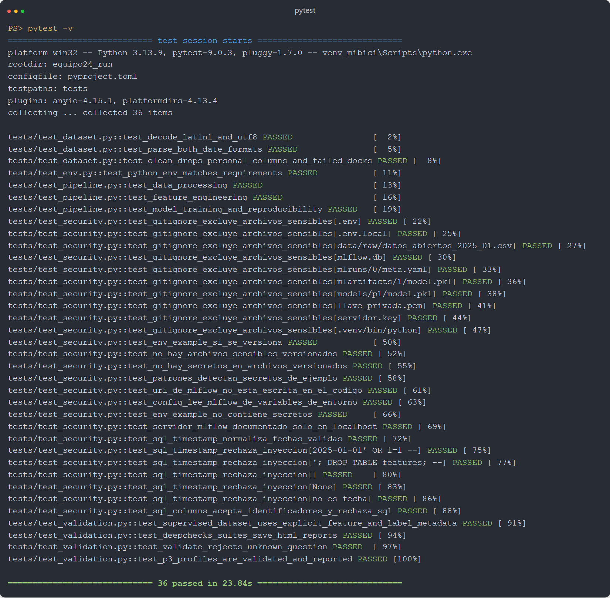
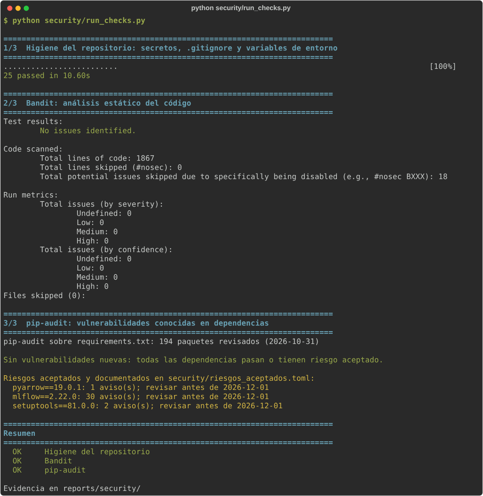
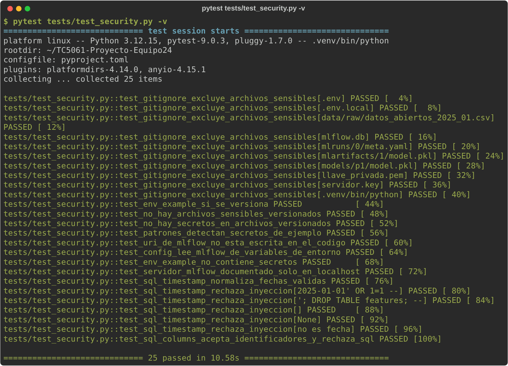

# TC5061-Proyecto-Equipo24 · MiBici

<a target="_blank" href="https://cookiecutter-data-science.drivendata.org/">
    
</a>

Proyecto integrador de **TC5061 Operaciones de aprendizaje automático (MLOps)**. Usamos los datos abiertos de
[MiBici](https://www.mibici.net/es/datos-abiertos/), el sistema de bicicleta pública del Área Metropolitana de
Guadalajara, para responder tres preguntas de operación con Machine Learning.

## Preguntas del proyecto

| # | Pregunta de negocio | Tarea | Planteamiento | Quién lo usa |
|---|---|---|---|---|
| P1 | ¿Cuántos viajes se iniciarán en una estación o zona en un periodo futuro? | Regresión | Salidas por estación en cada hora del día siguiente (horizonte 24 h), agregables a zona y día | Operador del sistema (flota) |
| P2 | ¿Una estación estará en riesgo de quedarse sin bicicletas o sin anclajes? | Clasificación | Clase {normal, vaciado, saturación} por estación y hora del día siguiente, con etiqueta proxy de flujo neto y huellas de censura | Equipo de rebalanceo |
| P3 | ¿Qué grupos de estaciones comparten patrones de uso y dónde se ubican? | Clustering | Grupos de estaciones por perfil horario de salidas y llegadas, proyectados en el mapa | Planeación urbana |

El ML Canvas, la formulación completa y la arquitectura están en [`references/`](references/).

## Datos

| | |
|---|---|
| Fuente | Portal de datos abiertos de MiBici (`datos_abiertos_AAAA_MM.csv` y `nomenclatura_2026_09.csv`) |
| Rango | **2022-01 a 2026-09** (57 meses). Se excluye 2014-2021 porque la pandemia cambió los hábitos de viaje |
| Tamaño | 21,036,075 viajes, 1.8 GB en CSV, 473 estaciones con viajes, 484 en la nomenclatura |
| Retos de formato | 36 meses en Latin-1 y 21 en UTF-8; encabezado corrupto en 2024-02 y 2024-05; fechas `DD/MM/AAAA h:mm` en 2023-11, 2024-09 y 2024-10 |
| Datos personales | `Usuario_Id`, `Genero` y `Año_de_nacimiento` se eliminan en la ingesta; los modelos solo usan agregados por estación y hora |
| Partición | Temporal: entrenamiento hasta 2025-06, validación 2025-07 a 2025-12, prueba 2026-01 a 2026-09 |

Los datos **no** se suben a Git. Se reconstruyen con un comando y se versionan con
[`data_manifest.json`](data_manifest.json): hash SHA-256 y número de registros de cada archivo. Su huella corta
(`data_version`) se registra como parámetro y etiqueta en cada run de MLflow.

## Estructura del repositorio

Generada con [Cookiecutter Data Science](https://cookiecutter-data-science.drivendata.org/)
(`pipx install cookiecutter-data-science` y `ccds` con `include_code_scaffold = Yes`); ese resultado es el
primer commit del repositorio.

```
├── MLproject              <- Entry points de MLflow Projects (ingest, features, train, baselines)
├── python_env.yaml        <- Entorno para `mlflow run`
├── Makefile               <- Atajos: make data, make features, make experiment, make smoke
├── data_manifest.json     <- Versión de los datos (se genera con la ingesta; sí se versiona)
├── requirements.txt       <- Dependencias con versión fija
├── requirements-api.txt   <- Dependencias de ejecución de la API (las que instala la imagen)
├── Containerfile          <- Imagen OCI de la API (formato Dockerfile; Podman y Docker)
├── .dockerignore          <- Archivos que no entran al contexto de construcción de la imagen
├── data/                  <- Ignorado por Git
│   ├── raw/               <- CSV originales descargados del portal
│   ├── interim/           <- Parquet por mes, ya normalizado y sin datos personales
│   └── processed/         <- Panel estación × hora con features y perfiles de estaciones
├── models/                <- Modelos serializados (ignorado por Git)
├── notebooks/             <- Solo exploración: 1.0-jagg-exploracion-viajes.ipynb
├── references/            <- ML Canvas, propuesta y diagrama de arquitectura
├── reports/              <- Figuras y reportes HTML de validación
│   ├── figures/           <- Figuras de los modelos
│   ├── deepchecks/        <- Reportes HTML (se generan al validar datasets)
│   └── security/          <- Salidas de bandit, pip-audit y pruebas de seguridad (evidencia)
├── tests/                 <- Pruebas y generador de datos sintéticos
├── security/              <- Chequeos de seguridad (run_checks.py) y riesgos aceptados de dependencias
├── docs/seguridad.md      <- Revisión de seguridad: hallazgos, correcciones y riesgos aceptados
├── docs/contenedor.md     <- Evidencia de construcción, ejecución y pruebas del contenedor de la API
└── mibici/                <- Módulo del proyecto
    ├── config.py          <- Rutas, fechas, partición, semillas, umbrales y MLflow (único lugar)
    ├── dataset.py         <- Ingesta reproducible y manifiesto de datos
    ├── features.py        <- Panel estación × hora, rezagos, etiquetas P2 y perfiles P3
    ├── validation.py      <- Validación de integridad y drift con Deepchecks
    ├── modeling/train.py  <- CLI de entrenamiento (entry point `train` de MLproject)
    ├── modeling/tracking.py <- Registro en MLflow: tags, parámetros, figuras y modelo
    ├── modeling/p1_demand.py, p2_risk.py, p3_clusters.py <- Modelos y evaluación por pregunta
    ├── api/main.py, api/schemas.py <- API REST (FastAPI) del modelo P1 y sus esquemas Pydantic
    ├── modeling/predict.py<- Predicción batch (siguiente entrega)
    └── plots.py           <- Gráficas compartidas (siguiente entrega)
```

## Instalación

Requiere Python 3.12 (también funciona con 3.11 y 3.13) y un servidor de MLflow.

**macOS / Linux**

```bash
git clone https://github.com/<usuario>/TC5061-Proyecto-Equipo24.git
cd TC5061-Proyecto-Equipo24
python3.12 -m venv .venv
source .venv/bin/activate
pip install -r requirements.txt

cp .env.example .env        # MIBICI_TEAM=equipo24 y la URI de MLflow
```

**Windows (PowerShell)**

```powershell
git clone https://github.com/<usuario>/TC5061-Proyecto-Equipo24.git
cd TC5061-Proyecto-Equipo24
py -3.12 -m venv .venv
.\.venv\Scripts\Activate.ps1
python -m pip install -U pip
pip install -r requirements.txt

Copy-Item .env.example .env   # MIBICI_TEAM=equipo24 y la URI de MLflow
```

Si PowerShell bloquea la activación del entorno, ejecuta una vez
`Set-ExecutionPolicy -Scope CurrentUser RemoteSigned`. En `cmd` el entorno se activa con
`.venv\Scripts\activate.bat` y el archivo se copia con `copy .env.example .env`.

### Servidor de tracking con base de datos

El Model Registry de MLflow requiere un backend con base de datos, así que el servidor usa SQLite
(`mlflow.db`, excluido de Git junto con `mlartifacts/` y `mlruns/`). En otra terminal, desde la raíz
del repo y con el entorno virtual activado:

```bash
# macOS / Linux
mlflow server --backend-store-uri sqlite:///mlflow.db --artifacts-destination ./mlartifacts \
  --serve-artifacts --host 127.0.0.1 --port 5001
```

```powershell
# Windows (PowerShell, en una sola línea)
mlflow server --backend-store-uri sqlite:///mlflow.db --artifacts-destination ./mlartifacts --serve-artifacts --host 127.0.0.1 --port 5001
```

Usamos el puerto **5001** porque en macOS el 5000 lo ocupa el receptor de AirPlay (responde 403). En Linux
o Windows puede usarse `--port 5000`, ajustando la URI en `.env`. Después, en la terminal de trabajo:

```bash
# macOS / Linux
export MLFLOW_TRACKING_URI=http://localhost:5001
export MLFLOW_EXPERIMENT_NAME=mibici-equipo24
```

```powershell
# Windows (PowerShell)
$env:MLFLOW_TRACKING_URI = "http://localhost:5001"
$env:MLFLOW_EXPERIMENT_NAME = "mibici-equipo24"
```

`MIBICI_TEAM` y `MLFLOW_TRACKING_URI` también se leen de `.env` (`load_dotenv()` en `config.py`).

## Reproducir desde un clon limpio (MLflow Project)

Todas las corridas se lanzan desde el MLflow Project (`MLproject`), nunca desde un notebook.
`--env-manager local` usa el entorno virtual ya instalado con `requirements.txt`; sin esa bandera MLflow
crea un entorno nuevo a partir de `python_env.yaml` (mismas versiones fijas; requiere `pyenv`, que en
Windows es `pyenv-win`, por lo que ahí conviene usar siempre `--env-manager local`). Los comandos son los
mismos en macOS, Linux y Windows.

```bash
# 1. Ingesta: descarga 2022-01 a 2026-09, normaliza, limpia y escribe data_manifest.json
mlflow run . -e ingest --env-manager local

# 2. Entrenamiento: construye las features si faltan, entrena, evalúa y registra el run
mlflow run . -e train --env-manager local -P question=p1 -P model=rf -P n_estimators=300
mlflow run . -e train --env-manager local -P question=p2 -P model=hgb -P learning_rate=0.05
mlflow run . -e train --env-manager local -P question=p3 -P model=kmeans -P k=6

# Búsqueda de hiperparámetros con nested runs (una corrida padre y una hija por combinación)
mlflow run . -e search --env-manager local -P question=p1

# Baselines de la propuesta (P1, P2 y P3 en un solo comando)
mlflow run . -e baselines --env-manager local
```

### Puntos de entrada

| Entry point | Qué ejecuta | Parámetros |
|---|---|---|
| `ingest` | `mibici/dataset.py` | `start`, `end` (AAAA-MM) |
| `features` | `mibici/features.py` (opcional; `train` lo corre si faltan las features) | |
| `train` | `mibici/modeling/train.py` | `question`, `model` y los hiperparámetros de la tabla siguiente |
| `search` | Búsqueda de hiperparámetros con nested runs (`SEARCH_GRIDS` en `config.py`) | `question`, `sample_rows` |
| `baselines` | Los tres baselines de la propuesta | |
| `register` | Registra un run en el Model Registry con nombre canónico y linaje completo | `question`, `run_id`, `alias` (por defecto `champion`) |

Todo parámetro que no se indique vale `config` y se toma de `mibici/config.py` (`START_MONTH`, `END_MONTH`,
`DEFAULT_MODEL`, `HYPERPARAMS`, `TRAIN_SAMPLE_ROWS`, `SEED`). Así `MLproject` no repite rutas, fechas ni
semillas. En cada run, los parámetros con el nombre del `MLproject` muestran lo que se pasó en la línea de
comandos y los parámetros `hp_*` y `estimator` muestran el valor efectivo usado.

### Modelos e hiperparámetros por pregunta

| Pregunta | `model` | Hiperparámetros que usa | Por defecto (`config.py`) |
|---|---|---|---|
| P1 demanda | `baseline`, `poisson`, `rf`, `hgb` | poisson: `alpha` · rf: `n_estimators`, `max_depth`, `min_samples_leaf` · hgb: `max_iter`, `learning_rate`, `max_depth`, `min_samples_leaf` | `hgb` (pérdida Poisson) |
| P2 riesgo | `baseline`, `logreg`, `rf`, `hgb` | logreg: `C` · rf y hgb: como en P1 | `hgb` con pesos de clase, calibrado |
| P3 tipologías | `municipio`, `kmeans`, `ward`, `gmm` | `k` | `kmeans`, `k=5` |

- **P1:** entrena con una muestra determinista de 2 millones de filas estación-hora (hash de estación,
  hora y semilla). Métricas `val_`/`test_`: mae, rmse, wape, poisson_deviance, wape_station_day,
  wape_baseline, wape_poisson_floor, `gap_closed` (fracción de la brecha baseline → piso cerrada) y
  `dm_pvalue` (Diebold-Mariano contra el baseline).
- **P2:** entrena con todas las horas de riesgo y una muestra de las normales; calibra las probabilidades
  (isotónica) con validación y alerta si P(riesgo) ≥ 1/(1+c). Métricas: expected_cost_per_1000 (y el del
  baseline en las mismas filas), cost_reduction_vs_baseline, precision/recall/f1 por clase,
  avg_precision por clase de riesgo, brier_risk, alerts_per_day.
- **P3:** silhouette, davies_bouldin, calinski_harabasz, Jaccard bootstrap (media y mínimo por cluster) y
  ARI contra el municipio.
- P1 y P2 registran el modelo con firma y ejemplo de entrada (`model/`), listo para el Model Registry.
  P3 registra un asignador (estandarización + PCA + centroide más cercano) que ubica cualquier estación,
  nueva o existente, en el grupo cuyo centroide está más cerca.

### Experimentación: búsquedas, etiquetas y artefactos

**Búsquedas con nested runs.** `mlflow run . -e search -P question=p1|p2|p3` crea una corrida padre
(`p1-search-hgb`, `p2-search-hgb`, `p3-search-kmeans`) y una corrida hija por cada combinación de la rejilla
definida en `SEARCH_GRIDS` (`config.py`). Al terminar, la corrida padre registra la tabla de resultados
(`data/<pregunta>_search_<modelo>_resultados.csv`), la etiqueta `best_child_run_id`, la etiqueta
`best_hyperparams` y la métrica `best_<métrica>`. La mejor hija se elige con `SELECTION_METRIC`, calculada en
**validación** (nunca en prueba): `val_wape` en P1, `val_expected_cost_per_1000` en P2 y `train_silhouette`
en P3.

**Etiquetas para filtrar en la interfaz** (además de `team`, `question`, `git_commit`, `git_dirty` y
`data_version`):

| Etiqueta | Valores | Filtro de ejemplo en MLflow |
|---|---|---|
| `stage_of_work` | `baseline`, `search`, `candidate` | `tags.stage_of_work = 'candidate'` |
| `model_family` | `baseline`, `glm`, `bagging_trees`, `boosting_trees`, `partitional`, `hierarchical`, `probabilistic` | `tags.model_family = 'boosting_trees'` |
| `model` | nombre del estimador (`hgb`, `rf`, `kmeans`, ...) | `tags.question = 'P1' and tags.model = 'hgb'` |

**Artefactos de cada corrida**, organizados en subcarpetas y sin datos personales:

| Carpeta | Contenido |
|---|---|
| `model/` | Modelo con firma (`signature`) y ejemplo de entrada |
| `plots/` | P1: WAPE por nivel de demanda, real contra predicho y residuales · P2: matriz de confusión y curva precisión-recall · P3: mapa y perfiles horarios por grupo |
| `data/` | `data_manifest.json` (versión de los datos) y tablas agregadas por estación o por nivel de demanda |
| `config/` | `run_config.json` (parámetros y etiquetas efectivos), `config.py`, `MLproject`, `python_env.yaml` y `requirements.txt` |

El conjunto de entrenamiento se registra además con `mlflow.log_input` (pestaña *Datasets* del run): MLflow
guarda su esquema, perfil y digest, no las filas. Las figuras ya no se copian a `reports/figures/` en cada
corrida, porque esa carpeta está en Git y sobrescribirla marcaría el árbol como modificado
(`git_dirty=true`). Para copiarlas, exporta `MIBICI_SAVE_FIGURES=1`.

### Modelo elegido y registro en el Model Registry

Cada corrida de `train` (no-baseline, no-búsqueda) registra automáticamente su modelo
en el MLflow Model Registry con nombres canónicos:

| Pregunta | Nombre en el registry |
|---|---|
| P1 demanda | `mibici-equipo24-p1-demanda` |
| P2 riesgo | `mibici-equipo24-p2-riesgo` |
| P3 tipologías | `mibici-equipo24-p3-grupos` |

Cada versión conserva su **linaje completo** en las etiquetas de la versión:
`question`, `estimator`, `experiment_name`, `source_run_id`, `source_run_name`,
`git_commit`, `git_dirty`, `data_version`, `team`, `model_family` y `stage_of_work`.

Para **promover el modelo elegido** tras comparar corridas en la UI, usa el entry point
`register` con el `run_id` de la corrida ganadora y el alias `champion`:

```bash
# Desde la UI de MLflow, copia el run_id de la corrida elegida
mlflow run . -e register --env-manager local \
  -P question=p1 -P run_id=<run_id> -P alias=champion

# O directamente como módulo
python -m mibici.modeling.train register \
  --question p1 --run-id <run_id> --alias champion
```

El entry point también funciona para P2 y P3.

| Pregunta | Modelo elegido | Comando para reproducirlo |
|---|---|---|
| P1 | _por definir tras comparar runs_ | `mlflow run . -e train --env-manager local -P question=p1 -P model=...` |
| P2 | _por definir tras comparar runs_ | `mlflow run . -e train --env-manager local -P question=p2 -P model=...` |
| P3 | _por definir tras comparar runs_ | `mlflow run . -e train --env-manager local -P question=p3 -P model=...` |

### API REST del modelo (FastAPI)

`mibici/api/` sirve el modelo de demanda (P1) como API REST. Al arrancar, la API **recupera el modelo del
Model Registry por nombre y alias**: `models:/mibici-equipo24-p1-demanda@champion`. La versión que
apunta a `@champion` se resuelve en ese momento y aparece en `/health`, de modo que promover otra versión no
requiere cambiar el código.

| Variable de entorno | Por defecto | Uso |
|---|---|---|
| `MLFLOW_TRACKING_URI` | `http://localhost:5001` (de `.env`) | Servidor de MLflow con el registry. Dentro de un contenedor: `http://host.containers.internal:5001` |
| `MODEL_URI` | `models:/mibici-equipo24-p1-demanda@champion` | URI del modelo. También acepta una carpeta local con el modelo ya descargado del registry (para empaquetarlo en la imagen) |
| `MODEL_ALIAS` | `champion` | Alias del registry si no se indica `MODEL_URI` |

**Opción elegida:** cargar el modelo desde el registry con `MLFLOW_TRACKING_URI`. Así la API siempre usa la
versión en producción y el linaje (run, commit y versión de datos) queda en MLflow. La alternativa de
empaquetar el modelo descargado se activa con `MODEL_URI=/ruta/al/modelo`, sin cambiar el código.

**Endpoints**

| Método y ruta | Qué hace |
|---|---|
| `GET /health` | Estado del servicio, modelo y versión cargados |
| `POST /predict` | Predicción para una estación en una hora |
| `POST /predict/lote` | Predicción para hasta 1,000 estación-horas en una sola petición |
| `GET /docs` | Documentación interactiva (Swagger) generada por FastAPI |

**Validación de entradas y salidas (Pydantic, `mibici/api/schemas.py`).** La entrada son las 13 variables
`P1_FEATURES` con las que se entrenó el modelo. Se rechaza con HTTP 422 cualquier petición con variables
faltantes o desconocidas, con valores fuera de rango (hora 0-23, día 0-6, mes 1-12, indicadores 0/1, rezagos
no negativos, capacidad 1-100, coordenadas dentro del Área Metropolitana de Guadalajara) o con `is_weekend`
inconsistente con `dow`. La salida se recorta a valores no negativos y se valida que sea finita.

**Levantar la API en local** (con el servidor de MLflow corriendo y los modelos registrados):

```bash
uvicorn mibici.api.main:app --host 127.0.0.1 --port 8000
```

**Ejemplo de petición y respuesta**

```bash
curl -X POST http://localhost:8000/predict -H "Content-Type: application/json" -d '{
  "hour": 8, "dow": 1, "month": 9, "is_weekend": 0, "is_holiday": 0, "is_quincena": 0,
  "dep_lag_24h": 6, "dep_lag_168h": 7, "dep_mean_7d": 5.4, "dep_mean_28d": 5.9,
  "capacity": 19, "lat": 20.6767, "lon": -103.3475
}'
```

```json
{"viajes_estimados": 6.865}
```

`GET /health` responde:

```json
{"estado": "ok", "modelo": "mibici-equipo24-p1-demanda", "version": "1",
 "uri": "models:/mibici-equipo24-p1-demanda@champion"}
```

Las pruebas de la API (`tests/test_api.py`) usan un modelo falso, así que corren sin servidor de MLflow
como parte de `pytest`.

### Contenedor de la API (Containerfile)

El `Containerfile` de la raíz empaqueta la API con todas sus dependencias en una imagen que cumple el
estándar OCI. Usa el formato Dockerfile, así que sirve tanto con Podman como con Docker.

| Elemento | Qué hace |
|---|---|
| Imagen base | `python:3.12-slim-bookworm`, la misma versión de Python con la que se entrenó el modelo |
| Dependencias | `requirements-api.txt`: solo lo necesario para servir el modelo (FastAPI, Uvicorn, MLflow, scikit-learn, pandas, numpy, python-dotenv, loguru), con las mismas versiones fijas que `requirements.txt`. Se instalan en una capa propia, que se reutiliza mientras no cambien |
| Código | Solo el paquete `mibici/`. `.dockerignore` deja fuera `.env`, `.venv`, `data/`, `models/`, `mlflow.db`, pruebas, reportes y notebooks |
| Seguridad | Se ejecuta con un usuario sin privilegios (`appuser`, uid 10001) y sin credenciales dentro de la imagen |
| Arranque | `uvicorn mibici.api.main:app --host 0.0.0.0 --port 8000` (puerto 8000 expuesto) |
| Variables | `MLFLOW_TRACKING_URI=http://host.containers.internal:5001` y `MODEL_ALIAS=champion` por defecto. Se pueden cambiar con `-e` al ejecutar, igual que `MODEL_URI` |

El modelo **no** se copia a la imagen. Al arrancar, el contenedor lo recupera del Model Registry, así que la
misma imagen sirve cualquier versión que tenga el alias `@champion`.

**1. Construir la imagen** (desde la raíz del repo):

```bash
# Podman (lee el Containerfile automáticamente)
podman build -t mibici-api:1.0.0 .

# Docker (hay que indicar el archivo)
docker build -f Containerfile -t mibici-api:1.0.0 .
```

**2. Ejecutar el contenedor** con el servidor de MLflow corriendo en el anfitrión (puerto 5001) y el modelo
P1 registrado con el alias `champion`:

```bash
# Podman
podman run --rm -p 8000:8000 --name mibici-api mibici-api:1.0.0

# Docker: el anfitrión se llama host.docker.internal
docker run --rm -p 8000:8000 --name mibici-api \
  -e MLFLOW_TRACKING_URI=http://host.docker.internal:5001 mibici-api:1.0.0
```

En Linux con Docker, agrega `--add-host=host.docker.internal:host-gateway`. Si el contenedor no alcanza el
servidor, levanta MLflow con `--host 0.0.0.0` en lugar de `127.0.0.1`.

**Alternativa sin servidor de MLflow:** descarga el modelo del registry y móntalo como volumen de solo
lectura:

```bash
mlflow artifacts download --artifact-uri "models:/mibici-equipo24-p1-demanda@champion" --dst-path models/p1
podman run --rm -p 8000:8000 -v "$(pwd)/models/p1:/modelo:ro" -e MODEL_URI=/modelo mibici-api:1.0.0
```

En PowerShell, usa `-v "${PWD}/models/p1:/modelo:ro"`. En este modo, `/health` reporta `"version": "local"`.

**3. Probar el contenedor.** Es la misma API de la sección anterior en `http://localhost:8000`:

```bash
curl http://localhost:8000/health
curl -X POST http://localhost:8000/predict -H "Content-Type: application/json" -d '{
  "hour": 8, "dow": 1, "month": 9, "is_weekend": 0, "is_holiday": 0, "is_quincena": 0,
  "dep_lag_24h": 6, "dep_lag_168h": 7, "dep_mean_7d": 5.4, "dep_mean_28d": 5.9,
  "capacity": 19, "lat": 20.6767, "lon": -103.3475
}'
```

Respuestas esperadas (HTTP 200):

```json
{"estado": "ok", "modelo": "mibici-equipo24-p1-demanda", "version": "1",
 "uri": "models:/mibici-equipo24-p1-demanda@champion"}
```

```json
{"viajes_estimados": 6.865}
```

**Petición por lote** (varias estación-horas en una sola llamada):

```bash
curl -X POST http://localhost:8000/predict/lote -H "Content-Type: application/json" -d '{
  "registros": [
    {"hour": 8, "dow": 1, "month": 9, "is_weekend": 0, "is_holiday": 0, "is_quincena": 0,
     "dep_lag_24h": 6, "dep_lag_168h": 7, "dep_mean_7d": 5.4, "dep_mean_28d": 5.9,
     "capacity": 19, "lat": 20.6767, "lon": -103.3475},
    {"hour": 18, "dow": 4, "month": 9, "is_weekend": 0, "is_holiday": 0, "is_quincena": 0,
     "dep_lag_24h": 12, "dep_lag_168h": 10, "dep_mean_7d": 11.2, "dep_mean_28d": 10.5,
     "capacity": 24, "lat": 20.6767, "lon": -103.3475}
  ]
}'
```

Respuesta obtenida en la prueba del contenedor con el modelo montado como volumen (`MODEL_URI=/modelo`,
ver [`docs/contenedor.md`](docs/contenedor.md)):

```json
{"modelo": "mibici-equipo24-p1-demanda", "version": "local",
 "predicciones": [{"viajes_estimados": 2.425}, {"viajes_estimados": 8.03}]}
```

Las predicciones salen en el mismo orden que los registros enviados. Los valores exactos dependen de la
versión del modelo que se cargue.

**En Windows (PowerShell)**, `curl` es un alias de `Invoke-WebRequest`; usa `Invoke-RestMethod`:

```powershell
Invoke-RestMethod http://localhost:8000/health

$body = @{
  hour = 8; dow = 1; month = 9; is_weekend = 0; is_holiday = 0; is_quincena = 0
  dep_lag_24h = 6; dep_lag_168h = 7; dep_mean_7d = 5.4; dep_mean_28d = 5.9
  capacity = 19; lat = 20.6767; lon = -103.3475
} | ConvertTo-Json

Invoke-RestMethod -Uri http://localhost:8000/predict -Method Post -Body $body -ContentType "application/json"
```

**Entrada inválida.** Una petición con `"hour": 25` no llega al modelo; la API responde HTTP 422 con el campo
que falló:

```json
{"detail": [{"type": "less_than_equal", "loc": ["body", "hour"],
             "msg": "Input should be less than or equal to 23", "input": 25, "ctx": {"le": 23}}]}
```

La evidencia completa de construcción (`podman build`), ejecución (`podman run`) y pruebas de los endpoints
está en [`docs/contenedor.md`](docs/contenedor.md).

La documentación interactiva queda en `http://localhost:8000/docs`. Si el modelo no se puede cargar al
arrancar (servidor inaccesible o alias inexistente), el contenedor termina y el error aparece en la terminal.
Si lo ejecutas en segundo plano (`-d`, sin `--rm`), consulta el error con `podman logs mibici-api` o
`docker logs mibici-api`.

El `Containerfile` no declara `HEALTHCHECK` porque el formato de imagen OCI no lo admite (Podman lo
ignora). Para monitorear el servicio, consulta `GET /health`.

### Sin MLflow Project

Los mismos pasos como módulos de Python (útil para depurar):

```bash
python -m mibici.dataset
python -m mibici.dataset verify          # comprueba los CSV contra el manifiesto
python -m mibici.features
python -m mibici.validation --question all  # valida P1, P2 y perfiles P3
python -m mibici.modeling.train run --question p1 --model rf --n-estimators 300
python -m mibici.modeling.train baselines
```

### Validación de datasets

Ejecuta la validación después de construir los datos procesados con `python -m mibici.features`.
Deepchecks revisa la integridad de entrenamiento y prueba de P1 y P2, compara ambos periodos para
identificar drift y posibles problemas de partición, y revisa la integridad de los perfiles de estaciones
de P3. Para P1 y P2 se usa una muestra determinista de hasta 10,000 filas por conjunto de forma
predeterminada; ajusta el tamaño con `--sample-rows`.

```bash
python -m mibici.validation --question all
python -m mibici.validation --question p1 --sample-rows 20000
```

`--question` acepta `all`, `p1`, `p2` o `p3`. La opción `all` genera siete reportes HTML en
`reports/deepchecks/`: integridad de train y test, y comparación train/test para P1 y P2, además de
integridad de los perfiles P3. Los reportes no contienen datos personales: las entradas de P1/P2 son
features agregadas por estación y hora.

`python -m mibici.validation --question all`: se generan los siete reportes de DeepChecks.



Prueba de punta a punta **sin internet** con datos sintéticos que imitan los formatos del portal:

```bash
make smoke
```

En Windows `make` no viene instalado (puede instalarse con `choco install make`). Sin él, los pasos
equivalentes en PowerShell son:

```powershell
python tests/make_sample_data.py data/sample
python -m mibici.dataset --source-dir data/sample --start 2025-01 --end 2026-02
python -m mibici.features
python -m pytest -q tests
```

### Pruebas y chequeos

Todas las pruebas viven en `tests/`, un archivo por componente del módulo `mibici/`. La configuración de
pytest está en `pyproject.toml` (`[tool.pytest.ini_options]`), así que **un solo comando** corre la suite
completa desde la raíz del repositorio:

```bash
pytest            # o: make test
```

| Archivo | Qué prueba | Casos límite que cubre |
|---|---|---|
| `tests/test_dataset.py` | Ingesta: decodificación Latin-1/UTF-8, los dos formatos de fecha del portal y limpieza | Anclajes fallidos, columnas personales que deben eliminarse |
| `tests/test_pipeline.py` | Procesamiento de datos, feature engineering y **reproducibilidad del entrenamiento** (misma semilla, mismas predicciones y métricas; otra semilla, predicciones distintas) | Umbral exacto de anclaje fallido, duraciones de 0 s, negativas y de 3 h, duplicados, DataFrame vacío, festivos y quincenas en años bisiestos, modelo no soportado, demanda nula |
| `tests/test_validation.py` | Validación de datos con DeepChecks: metadatos de features y etiqueta, reportes HTML de P1, P2 y P3 | Pregunta inválida |
| `tests/test_security.py` | Higiene del repositorio: `.gitignore`, secretos, URI de MLflow por variable de entorno, SQL seguro | Intentos de inyección SQL |
| `tests/test_env.py` | `python_env.yaml` usa las mismas versiones que `requirements.txt` | |

`tests/make_sample_data.py` genera datos sintéticos para la prueba de punta a punta (`make smoke`).
`tests/test_model_registry.py` no tiene pruebas de pytest: es un script que verifica los modelos
`@champion` contra un servidor de MLflow en marcha (`python tests/test_model_registry.py`).

Para correr **todo** (pruebas, validación de datos con DeepChecks y chequeos de seguridad):

```bash
make check
```

En Windows sin `make`, los mismos tres pasos son:

```powershell
pytest
python -m mibici.validation --question all
python security/run_checks.py
```

Algunas variantes útiles:

```bash
pytest tests/test_pipeline.py -v      # solo las pruebas de procesamiento, features y reproducibilidad
pytest -k reproducibility             # solo la prueba de reproducibilidad
```

**Evidencia de ejecución**

`pytest -v`: las 36 pruebas de la suite pasan.



### Chequeos de seguridad

Un solo comando revisa credenciales y datos sensibles, analiza el código con
[bandit](https://bandit.readthedocs.io/) y busca vulnerabilidades conocidas en las dependencias con
[pip-audit](https://pypi.org/project/pip-audit/). Ambas herramientas vienen en `requirements.txt`.

```bash
python security/run_checks.py               # o: make security
python security/run_checks.py --skip-audit  # sin pip-audit (no requiere internet)
python security/run_checks.py --installed   # audita el entorno activo en vez de requirements.txt
```

| Paso | Qué revisa | Falla si... |
|---|---|---|
| 1. Higiene del repositorio (`tests/test_security.py`) | `.gitignore` cubre `.env`, datos, MLflow, modelos y llaves; nada sensible versionado; sin llaves, tokens ni contraseñas escritas; URI de MLflow solo por variable de entorno; servidor solo en `127.0.0.1`; fechas y columnas validadas antes de armar SQL | alguna prueba falla |
| 2. Bandit | `mibici/`, `security/`, `guardarmodelos.py` y `verificarmodelos.py` (config en `[tool.bandit]` de `pyproject.toml`) | hay un hallazgo de severidad media o alta |
| 3. pip-audit | Dependencias de `requirements.txt` contra las bases de PyPI/OSV | aparece una vulnerabilidad no justificada en `security/riesgos_aceptados.toml` |

Las salidas quedan en `reports/security/` (`bandit.txt`, `pip_audit.txt`, `repo_hygiene.txt` y los JSON).
Las pruebas de seguridad también corren con el resto de la suite (`pytest tests`). Los hallazgos de la
revisión, lo que se corrigió y por qué se aceptan temporalmente los avisos de mlflow, pyarrow y setuptools
están en [`docs/seguridad.md`](docs/seguridad.md).

**Credenciales.** Ninguna credencial va en el código ni en Git. Copia `.env.example` a `.env` y escribe ahí
los valores de tu máquina; `mibici/config.py` los lee con `python-dotenv`. Si el servidor de MLflow usa
autenticación, `MLFLOW_TRACKING_USERNAME` y `MLFLOW_TRACKING_PASSWORD` van solo en tu `.env`.

**Evidencia de ejecución**

`python security/run_checks.py`: los tres pasos pasan.



`pytest tests/test_security.py -v`: 25 pruebas de seguridad.



## Buenas prácticas y dónde se aplican

| Práctica | Cómo se aplica |
|---|---|
| Un experimento por proyecto y runs con nombre descriptivo | `MLFLOW_EXPERIMENT = mibici-<equipo>` en `config.py`; cada run tiene `run_name` explícito |
| Registrar lo necesario para reproducir | Params: `start_month`, `end_month`, partición, `data_version`, `seed`, `model` e hiperparámetros |
| Ligar el run al código y a la pregunta | Tags: `git_commit`, `git_dirty`, `question`, `team`, `data_version` |
| Métricas con el conjunto en el nombre | `val_mae`, `test_wape`, `train_silhouette`, etc. |
| Sin credenciales ni datos personales en MLflow | Solo métricas agregadas, gráficas y tablas por estación; columnas personales eliminadas en la ingesta |
| Notebooks solo para exploración | `notebooks/1.0-jagg-exploracion-viajes.ipynb`; la lógica vive en `mibici/` |
| Configuración en un solo lugar | Rutas, fechas, semillas, umbrales y MLflow en `mibici/config.py` |
| Dependencias fijas y entorno reproducible | `requirements.txt` con versiones exactas; `python_env.yaml` para `mlflow run` |
| Datos, modelos, MLflow y credenciales fuera de Git | `.gitignore` excluye `data/`, `mlruns/`, `mlartifacts/`, `*.db`, modelos, `.env` y llaves; `tests/test_security.py` lo verifica |
| Configuración sensible por variables de entorno | `.env` (no versionado) a partir de `.env.example`; ningún script escribe la URI de MLflow en el código |
| Seguridad del código y dependencias | `python security/run_checks.py`: bandit sin hallazgos y pip-audit sin vulnerabilidades no justificadas ([`docs/seguridad.md`](docs/seguridad.md)) |
| Sin fuga de información | Features con corte a las 23:59 del día anterior; umbrales y perfiles solo con entrenamiento |

## Flujo de trabajo con Git

- **GitHub Flow.** `main` está protegida: nadie hace push directo; todo cambio entra por Pull Request con al
  menos una revisión aprobada.
- **Ramas:** `tipo/descripcion-corta`, con tipo `feat`, `fix`, `docs`, `exp` (experimentos) o `chore`.
  Ejemplo: `feat/ingesta-mibici`, `exp/p1-lightgbm`.
- **Commits:** [Conventional Commits](https://www.conventionalcommits.org/es/v1.0.0/), en español:
  `feat(dataset): detecta codificación por archivo`, `fix(features): rezago sin fuga`.
- **Pull Requests:** se usa la plantilla `.github/pull_request_template.md` (qué cambia, pregunta que atiende,
  cómo se probó y enlace al run de MLflow si aplica). Cada integrante abre al menos un PR y revisa al menos uno
  de otra persona; el autor no aprueba su propio PR.
- **Protección de `main`** (Settings → Branches → Add branch ruleset): requerir Pull Request antes de
  integrar, al menos 1 aprobación, descartar aprobaciones al subir nuevos commits y bloquear force push.

## Integrantes y roles

| Integrante | Rol principal |
|---|---|
| José Alfredo Gutiérrez Guerra | _por definir_ |
| Antonio Abraham Díaz Arvizu | Integrante |
| Damián López Virgen | Analista de Datos y Visualización |
| José Antonio Padilla Pereira | Integrante |
