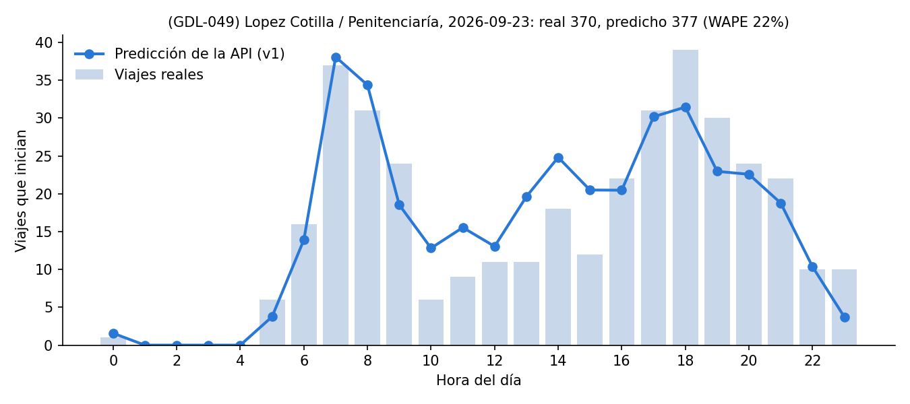

# Demo funcional de la API de demanda (P1)

Demo de 5 a 7 minutos que muestra la API operativa respondiendo a **peticiones reales**: las entradas salen
del panel de MiBici para el **miércoles 23 de septiembre de 2026**, un día del periodo de prueba que el
modelo no vio al entrenar, y cada predicción se compara con los viajes que realmente ocurrieron.

| Archivo | Qué es |
|---|---|
| `ejemplos/01_hora_pico.json` | Estación 51, (GDL-049) López Cotilla / Penitenciaría, la de más viajes en septiembre, a las 7:00 |
| `ejemplos/02_madrugada.json` | La misma estación a las 3:00 |
| `ejemplos/03_estacion_nueva.json` | Estación 428, (GDL-307) Federalismo / Juan Álvarez, abierta en junio de 2026, a las 7:00 |
| `ejemplos/04_invalido.json` | Petición con `hour = 25`, que la API debe rechazar |
| `ejemplos/05_lote_24h.json` | Las 24 horas de la estación 51, para `/predict/lote` |
| `ejemplos/real_2026-09-23.csv` | Viajes reales de cada ejemplo, para comparar |
| `demo.py` | Demo completa con Python; las peticiones usan la biblioteca estándar (`--grafica` opcional con matplotlib) |
| `demo.ps1` | La misma demo en PowerShell, sin Python |
| `generar_ejemplos.py` | Regenera los ejemplos desde `data/processed` (otro día u otra estación) |

## Antes de presentar

1. La base de MLflow del equipo (`mlflow.db` y `mlartifacts/` con los artefactos del champion) en la carpeta
   de `MLFLOW_STORE`. Sin los artefactos la API no arranca
   (ver [`docs/README_operacion_gobernanza.md`](../docs/README_operacion_gobernanza.md), falla 4.1).
2. Levantar el sistema y esperar a que la API esté *healthy* (alrededor de 1 minuto):

```powershell
$env:MLFLOW_STORE = "C:\ruta\a\la\base"
docker compose up -d --build
docker compose ps
```

## Correr la demo

Con el `.venv` del proyecto activado (`pip install -e .`), desde la raíz del repositorio:

```powershell
python demo/demo.py --pausa                     # con pausas entre pasos para ir explicando
python demo/demo.py --grafica demo/demo_24h.png  # además guarda la curva de 24 h
.\demo\demo.ps1 -Pausa                           # alternativa sin Python
```

Para probar el challenger: `docker compose --profile ab up -d` y agrega `--url http://localhost:8001`
(o `-Url` en PowerShell).

## Guion

| Paso | Qué se muestra | Qué decir |
|---|---|---|
| 1. `GET /health` | `estado=ok`, modelo `mibici-equipo24-p1-demanda`, versión 1, `@champion` | La API carga el modelo del Model Registry por alias; cambiar de versión es mover el alias, sin tocar código |
| 2. Hora pico | Predice **38.1** viajes; ocurrieron **37** | Con datos que el modelo nunca vio, acierta el pico de la mañana de la estación más concurrida |
| 3. Madrugada | Predice **0.0**; ocurrieron **0** | Aprendió el patrón horario: de noche no hay viajes |
| 4. Estación nueva | Predice **6.1**; ocurrieron **10** | Es su punto débil, documentado en el Model Card: sin historia larga subestima (WAPE de 101% en estaciones nuevas) |
| 5. Entrada inválida | **HTTP 422**, "Input should be less than or equal to 23" | La API valida rangos con Pydantic antes de llegar al modelo |
| 6. Lote de 24 h | Curva completa: **377 predichos contra 370 reales**, WAPE 22% | Una sola petición da el pronóstico del día para planear el rebalanceo; respuesta en milisegundos |

Cierre sugerido: la misma API pasó la prueba de carga (0% de errores hasta 150 usuarios, ~20 peticiones/s
con p95 ≤ 500 ms por contenedor de 1 CPU) y cuesta USD 0.17 por millón de predicciones
([`reports/carga/reporte_carga.md`](../reports/carga/reporte_carga.md)).



## Demo desde el navegador (alternativa)

En http://localhost:8000/docs abre `POST /predict` → **Try it out**, pega el contenido de
`ejemplos/01_hora_pico.json` y presiona **Execute**. Repite con los demás archivos; para el lote usa
`POST /predict/lote` con `ejemplos/05_lote_24h.json`.

## Resultado de referencia

Corrida contra la API con `@champion` v1 (corrida `ccb4c1e5...`), 2026-11-27:

| Petición | HTTP | Predicho | Real | Tiempo |
|---|---|---|---|---|
| `/health` | 200 | | | 10 ms |
| `/predict` hora pico | 200 | 38.1 | 37 | 12 ms |
| `/predict` madrugada | 200 | 0.0 | 0 | 7 ms |
| `/predict` estación nueva | 200 | 6.1 | 10 | 8 ms |
| `/predict` inválido | 422 | | | 2 ms |
| `/predict/lote` (24 registros) | 200 | 377 en el día | 370 | 8 ms |
