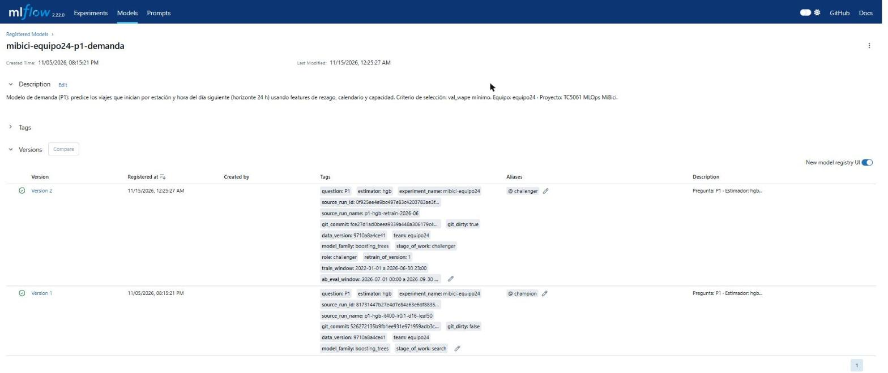
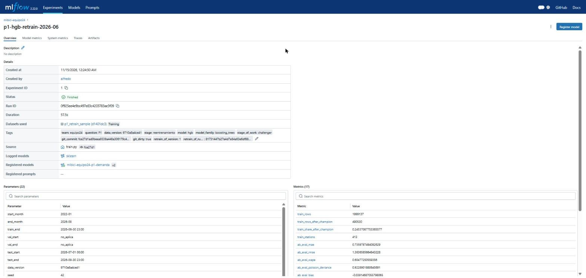
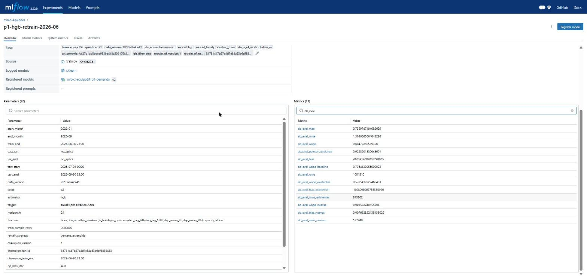

# Evidencia: versión alternativa del modelo P1 (challenger)

Complementa la sección "Versión alternativa del modelo P1 (challenger)" del [README](../README.md).
Documenta la ejecución del reentrenamiento, su registro en el Model Registry de MLflow y las métricas
obtenidas en el conjunto de evaluación reservado para el A/B testing.

## 1. Ejecución

```bash
python -m mibici.modeling.train retrain
```

| Concepto | Valor |
|---|---|
| Fecha de ejecución | 2026-11-15 00:24 (hora de Guadalajara) |
| Corrida de MLflow | `p1-hgb-retrain-2026-06` (run `0f925ee4e9bc497e83c4203783ae3f09`) |
| Experimento | `mibici-equipo24` |
| Estado y duración | Finished, 57.5 s |
| Código | commit `fce27d1` de la rama `feat/version-alternativa-p1-alfredo` |
| Versión de datos | `9710a8a4ce41` (la misma del champion) |

Salida relevante de la consola:

```text
Champion v1 (hgb, entrenado hasta 2025-06-30 23:00): {'max_iter': 400, 'learning_rate': 0.1, 'max_depth': 16, 'min_samples_leaf': 50}
Challenger: 1,999,137 filas, 490,530 posteriores al champion
Challenger en evaluación A/B: WAPE 0.605 (existentes 0.577, nuevas 0.999)
Modelo registrado: mibici-equipo24-p1-demanda v2 [run=0f925ee4, commit=fce27d1ad0be, datos=9710a8a4ce41]
Challenger registrado: mibici-equipo24-p1-demanda v2 @challenger (champion v1 sin cambios)
```

## 2. Registro en el Model Registry

El challenger quedó como **versión 2 del mismo modelo** `mibici-equipo24-p1-demanda`, con el alias
`@challenger`. El alias `@champion` sigue en la versión 1, por lo que la API no cambia de modelo hasta
que el A/B testing justifique la promoción.

| Versión | Alias | Corrida de origen | Ventana de entrenamiento | `stage_of_work` |
|---|---|---|---|---|
| 1 | `@champion` | `p1-hgb-it400-lr0.1-d16-leaf50` (`81731447`) | 2022-01-01 a 2025-06-30 | `search` |
| 2 | `@challenger` | `p1-hgb-retrain-2026-06` (`0f925ee4`) | 2022-01-01 a 2026-06-30 | `challenger` |

La versión 2 conserva el linaje habitual (`source_run_id`, `git_commit`, `data_version`, `model_family`)
y agrega las etiquetas `role=challenger`, `retrain_of_version=1`, `train_window` y `ab_eval_window`.



## 3. Corrida de entrenamiento

La corrida registra que se trata de un reentrenamiento de la versión 1 (`retrain_of_version`,
`champion_run_id`) y que el modelo resultante se registró como `v2`.



Hiperparámetros heredados del champion y ventanas efectivas de la corrida:

| Parámetro | Champion (v1) | Challenger (v2) |
|---|---|---|
| Estimador | HGB, pérdida Poisson | HGB, pérdida Poisson |
| `max_iter` / `learning_rate` / `max_depth` / `min_samples_leaf` | 400 / 0.1 / 16 / 50 | 400 / 0.1 / 16 / 50 |
| `train_sample_rows` | 2,000,000 | 2,000,000 |
| `seed` | 42 | 42 |
| `train_end` | 2025-06-30 23:00 | **2026-06-30 23:00** |
| Evaluación | prueba 2026-01 a 2026-09 | A/B 2026-07 a 2026-09 |

Composición de la muestra de entrenamiento del challenger:

| Métrica | Valor |
|---|---|
| `train_rows` | 1,999,137 |
| `train_rows_after_champion` | 490,530 |
| `train_share_after_champion` | 24.5% |
| `train_stations` | 413 |

## 4. Métricas en el conjunto de evaluación A/B

Conjunto: todas las estación-horas del 2026-07-01 al 2026-09-30, sin muestreo (1,001,510 filas).
Ninguna versión usó este periodo para entrenar ni para elegir hiperparámetros.

| Métrica | Total | Estaciones existentes | Estaciones nuevas |
|---|---|---|---|
| Filas | 1,001,510 | 813,562 | 187,948 |
| WAPE | **60.5%** | **57.7%** | **99.9%** |
| Sesgo (predicción menos real, viajes/h) | -0.039 | -0.050 | +0.008 |
| MAE | 0.736 | | |
| RMSE | 1.364 | | |
| Devianza Poisson | 0.923 | | |
| WAPE baseline (misma hora, semana anterior) | 73.6% | | |



## 5. Lectura de los resultados

- **El challenger supera al baseline ingenuo** en el conjunto de evaluación: 60.5% de WAPE contra 73.6%
  de la regla de la semana anterior.
- **El sesgo es prácticamente nulo**, igual que en el champion: el modelo no sobrepredice ni subpredice
  de forma sistemática.
- **En las estaciones nuevas el error sigue cerca de 100%.** Incluir el primer semestre de 2026 en el
  entrenamiento no fue suficiente para ese segmento, lo que respalda la recomendación de la
  [interpretación del drift](interpretacion_drift.md) de tratarlas con un modelo o regla de arranque
  en frío.
- **Estas cifras no constituyen todavía la comparación A/B.** El 101% de WAPE del champion en estaciones
  nuevas reportado en la interpretación del drift se midió sobre enero a septiembre de 2026, no sobre
  este conjunto. La decisión entre versiones requiere evaluar al champion sobre las mismas filas con
  `load_ab_eval_frame()` y `evaluate()` (punto 5).

## 6. Limitaciones

- **Nomenclatura de estaciones.** El archivo `data/interim/stations.parquet` se generó con la
  nomenclatura vigente del portal (`nomenclatura_2026_10.csv`, 470 estaciones), porque la de septiembre
  (484 estaciones) ya no está publicada. El cruce con el panel se hace por `station_id`, así que las
  horas de las estaciones que ya no aparecen quedan fuera tanto del entrenamiento del challenger como del
  conjunto de evaluación. El efecto en la comparación A/B es nulo, porque ambas versiones se evalúan
  sobre las mismas filas, pero el champion sí se entrenó con esas estaciones.
- **Etiqueta `git_dirty=true`.** La corrida se ejecutó desde WSL sobre una copia del repositorio en
  Windows. Git en WSL interpreta la diferencia de fin de línea (CRLF contra LF) como cambios sin
  commit. El código ejecutado corresponde al commit `fce27d1`.
