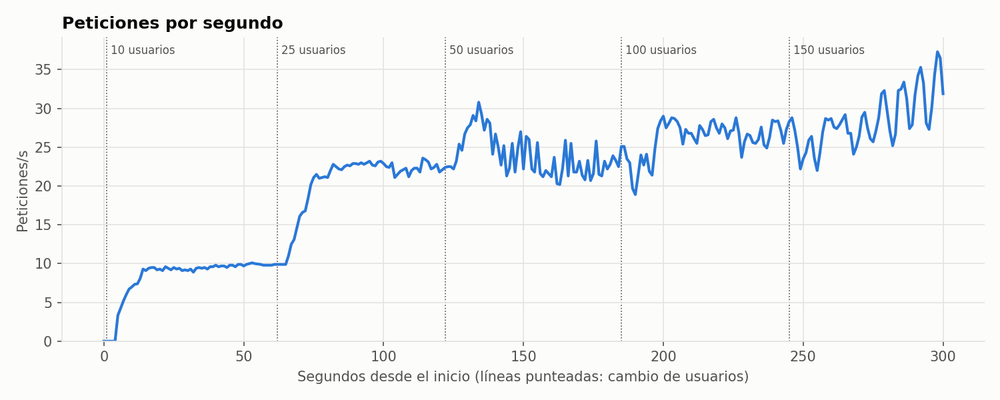
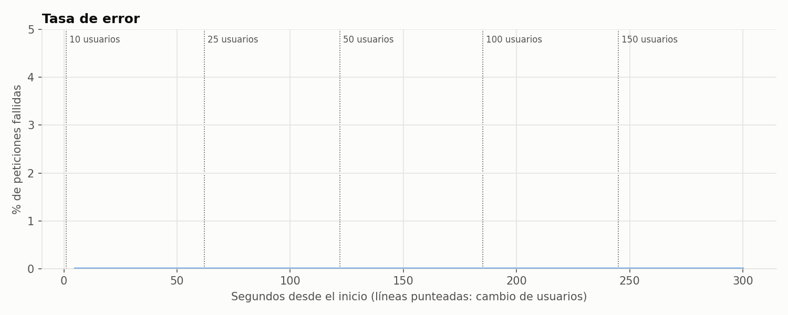
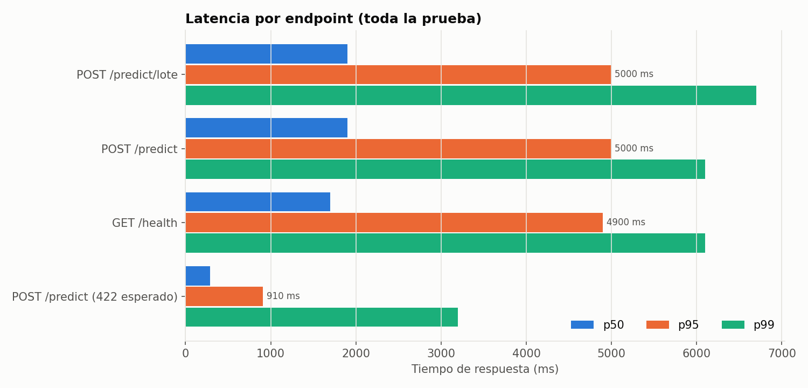
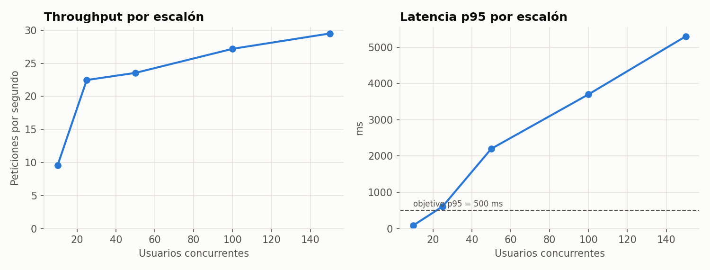
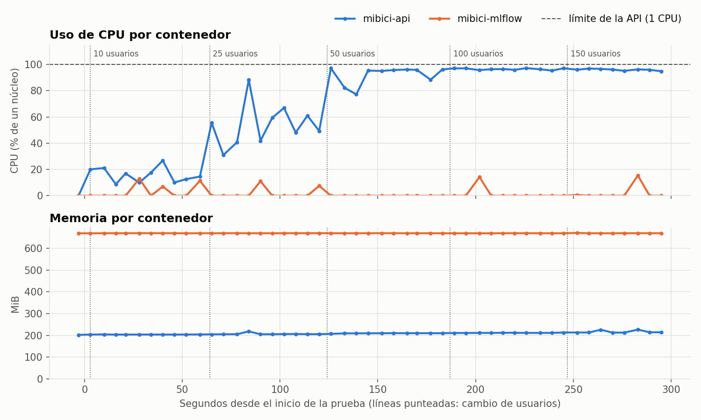
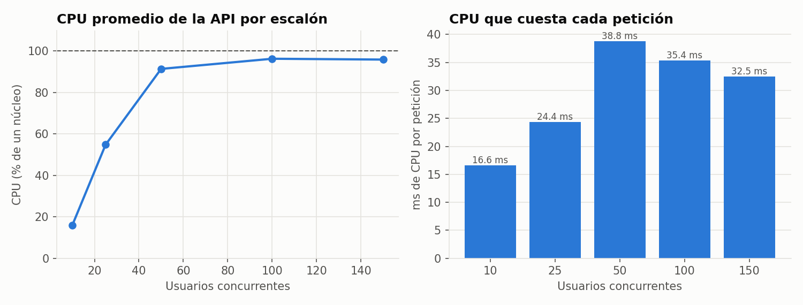
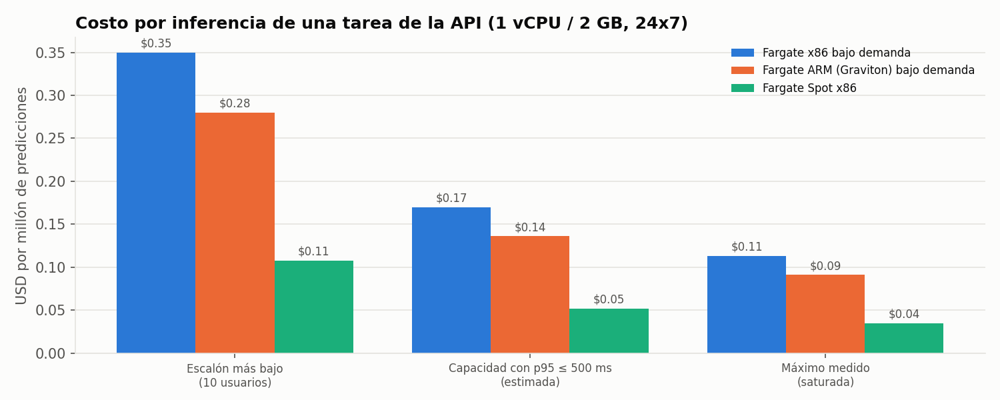

# Reporte de la prueba de carga y análisis FinOps · API de demanda (P1)

Generado el 2026-11-22 22:46 con `loadtest/generar_reporte.py` a partir de `reports/carga/locust_*.csv`.

## Escenario

Definido en [`loadtest/locustfile.py`](../../loadtest/locustfile.py): usuarios virtuales que piden pronósticos con una pausa de 0.5 a 1.5 s entre acciones. Mezcla de tareas: `POST /predict` (peso 10), `POST /predict/lote` con 24 estación-horas (peso 2), `GET /health` (peso 1) y una entrada inválida que debe responder 422 (peso 1, cuenta como éxito). La carga sube en escalones de usuarios; la API corre con los límites del `docker-compose.yml` (por defecto 1 CPU y 1 GB).

## Resultados globales

- Duración: 300 s · peticiones: 6,619 · fallas: 0 (0.00%)
- Throughput promedio: 22.1 peticiones/s · latencia p50 / p95 / p99: 1700 / 5000 / 6100 ms

| Endpoint | Peticiones | Fallas | Error % | Pet/s | Promedio ms | p50 ms | p95 ms | p99 ms | Máx ms |
|---|---|---|---|---|---|---|---|---|---|
| GET /health | 446 | 0 | 0.0 | 1.49 | 1917.6 | 1700 | 4900 | 6100 | 7294.0 |
| POST /predict | 4766 | 0 | 0.0 | 15.89 | 2081.2 | 1900 | 5000 | 6100 | 8215.0 |
| POST /predict (422 esperado) | 475 | 0 | 0.0 | 1.58 | 363.3 | 290 | 910 | 3200 | 4261.0 |
| POST /predict/lote | 932 | 0 | 0.0 | 3.11 | 2089.3 | 1900 | 5000 | 6700 | 8152.0 |
| **Total** | 6619 | 0 | 0.0 | 22.07 | 1948.1 | 1700 | 5000 | 6100 | 8215.0 |

## Por escalón de usuarios

Métricas de los segundos estables de cada escalón (sin las rampas). La latencia es la mediana de los percentiles móviles que Locust reporta cada segundo.

| usuarios | duracion_s | peticiones | rps | error_pct | p50_ms | p95_ms | p99_ms |
|---|---|---|---|---|---|---|---|
| 10 | 57 | 545 | 9.56 | 0.0 | 18.0 | 91.0 | 130.0 |
| 25 | 55 | 1236 | 22.47 | 0.0 | 50.0 | 610.0 | 790.0 |
| 50 | 56 | 1319 | 23.55 | 0.0 | 1300.0 | 2200.0 | 2750.0 |
| 100 | 53 | 1441 | 27.19 | 0.0 | 2900.0 | 3700.0 | 4000.0 |
| 150 | 53 | 1564 | 29.51 | 0.0 | 4500.0 | 5300.0 | 5600.0 |

### Observaciones

- **Capacidad sostenible:** 9.6 peticiones/s con 10 usuarios, p95 = 91 ms y 0.00% de error. Es el dato que usa el análisis FinOps.
- **Saturación:** a partir de 25 usuarios la p95 pasa de 91 ms a 610 ms (más del doble) mientras el throughput llega a 22.5 peticiones/s: la API está cerca de su límite de CPU.
- No hubo errores en ningún escalón.

## Gráficas

## Consumo de recursos durante la prueba

Muestras de `docker stats` cada ~6 s durante 298 s (49 por contenedor), tomadas con [`loadtest/monitor_recursos.py`](../../loadtest/monitor_recursos.py) mientras corría Locust. El CPU se expresa en % de un núcleo: 100% es el límite de la API en el compose. Datos crudos en [`docker_stats.csv`](docker_stats.csv); por escalón en [`recursos_por_etapa.csv`](recursos_por_etapa.csv).

| Contenedor | CPU prom % | CPU máx % | Memoria MiB (mín → máx) | Límite de memoria |
|---|---|---|---|---|
| `mibici-api` | 68.4 | 97.2 | 202 → 226 | 1024 MiB |
| `mibici-mlflow` | 1.6 | 15.4 | 668 → 670 | sin límite (memoria del anfitrión) |

### Por escalón de usuarios (API)

| Usuarios | Pet/s | p95 ms | Error % | Muestras | CPU prom % | CPU máx % | Memoria máx MiB | ms CPU / petición |
|---|---|---|---|---|---|---|---|---|
| 10 | 9.56 | 91.0 | 0.0 | 10 | 15.9 | 26.8 | 204.0 | 16.6 |
| 25 | 22.47 | 610.0 | 0.0 | 9 | 54.8 | 88.2 | 218.1 | 24.4 |
| 50 | 23.55 | 2200.0 | 0.0 | 9 | 91.4 | 97.0 | 210.0 | 38.8 |
| 100 | 27.19 | 3700.0 | 0.0 | 9 | 96.3 | 97.2 | 211.6 | 35.4 |
| 150 | 29.51 | 5300.0 | 0.0 | 8 | 95.9 | 96.8 | 226.1 | 32.5 |

### Interpretación

- **El cuello de botella es el CPU, no la memoria.** Con 10 usuarios la API usa 16% de su núcleo; desde 50 usuarios se queda pegada entre 91% y 96%, y a partir de ahí más usuarios solo alargan la cola: el throughput apenas sube y la p95 se dispara.
- **La memoria sobra.** La API ocupa 226 MiB de 1024 MiB (22%) y casi no crece con la carga: el modelo se carga una vez y cada predicción no retiene memoria.
- **Cada petición se vuelve más cara al saturar.** Con poca carga cuesta 16.6 ms de CPU; con la API saturada sube a 38.8 ms. Lo más probable es que el CPU extra se vaya en administrar la cola de peticiones (conexiones abiertas y cambios de contexto en un solo proceso), no en predecir.
- **MLflow casi no trabaja** (1.6% de CPU en promedio): la API descarga el modelo al arrancar y después no lo consulta. Ocupa ~670 MiB por tener el servidor encendido.

## Análisis FinOps: costo por inferencia

### Supuestos

- **Precio de referencia:** AWS Fargate en Linux, región US East (N. Virginia), consultado el 2026-11-22 en <https://aws.amazon.com/fargate/pricing/>:

| Tarifa | USD por vCPU-hora | USD por GB-hora |
|---|---|---|
| Fargate x86 bajo demanda | 0.04048 | 0.004445 |
| Fargate ARM (Graviton) bajo demanda | 0.03238 | 0.00356 |
| Fargate Spot x86 | 0.0124419 | 0.00136621 |

- **Tamaño de la tarea:** el compose limita la API a 1 CPU y 1 GB, pero en Fargate 1 vCPU exige de 2 a 8 GB; se factura la combinación válida más cercana, API (1 vCPU / 2 GB): $0.0494 por hora o $36.04 al mes encendida 24x7 en x86 bajo demanda.
- **Inferencia:** una predicción de demanda (una estación en una hora). En la mezcla de la prueba cada petición entrega en promedio **4.10 predicciones**, porque `/predict/lote` trae 24 por petición. Se reporta el costo por millón de peticiones y por millón de predicciones.
- **Costo por inferencia** = costo por hora de la tarea ÷ peticiones atendidas por hora. Supone la tarea siempre encendida y atendiendo el throughput del escenario.
- No incluye red (transferencia de datos), balanceador, registro de imágenes ni logs, que en un servicio chico pueden pesar más que el cómputo.

### Costo por escenario de carga

| Escenario | Pet/s | Nota |
|---|---|---|
| Escalón más bajo (10 usuarios) | 9.6 | p95 91 ms; la API va sobrada (la carga, no el CPU, limita) |
| Capacidad con p95 ≤ 500 ms (estimada) | 19.7 | interpolada entre el último escalón que cumple y el primero que no |
| Máximo medido (saturada) | 29.5 | p95 5300 ms: no es aceptable para usuarios |

| Tarifa | Escenario | Pet/s | USD/mes 24x7 | USD / millón de peticiones | USD / millón de predicciones |
|---|---|---|---|---|---|
| Fargate x86 bajo demanda | Escalón más bajo (10 usuarios) | 9.6 | 36.04 | 1.435 | 0.35 |
| Fargate x86 bajo demanda | Capacidad con p95 ≤ 500 ms (estimada) | 19.7 | 36.04 | 0.695 | 0.17 |
| Fargate x86 bajo demanda | Máximo medido (saturada) | 29.5 | 36.04 | 0.465 | 0.113 |
| Fargate ARM (Graviton) bajo demanda | Escalón más bajo (10 usuarios) | 9.6 | 28.84 | 1.148 | 0.28 |
| Fargate ARM (Graviton) bajo demanda | Capacidad con p95 ≤ 500 ms (estimada) | 19.7 | 28.84 | 0.556 | 0.136 |
| Fargate ARM (Graviton) bajo demanda | Máximo medido (saturada) | 29.5 | 28.84 | 0.372 | 0.091 |
| Fargate Spot x86 | Escalón más bajo (10 usuarios) | 9.6 | 11.08 | 0.441 | 0.108 |
| Fargate Spot x86 | Capacidad con p95 ≤ 500 ms (estimada) | 19.7 | 11.08 | 0.214 | 0.052 |
| Fargate Spot x86 | Máximo medido (saturada) | 29.5 | 11.08 | 0.143 | 0.035 |

**Resultado.** Con la API atendiendo su capacidad útil (~20 pet/s con p95 ≤ 500 ms), una tarea de $36.04/mes cuesta **$0.69 por millón de peticiones**, o **$0.17 por millón de predicciones** ($0.00000069 por petición). Subir hasta la saturación abarata la inferencia, pero con latencias de segundos que no sirven a un usuario: el costo correcto es el de la capacidad que cumple el objetivo de latencia.

### El costo real depende del tráfico

El cómputo se paga por tarea encendida, no por petición. Con poco tráfico la tarea mínima pasa casi todo el tiempo ociosa y el costo por inferencia se multiplica; con mucho tráfico se agregan tareas de ~20 pet/s cada una (x86 bajo demanda, sin contar MLflow):

| Tráfico promedio (pet/s) | Tareas de la API | Utilización % | USD/mes | USD / millón de peticiones |
|---|---|---|---|---|
| 0.5 | 1 | 2.5 | 36.04 | 27.43 |
| 2.0 | 1 | 10.1 | 36.04 | 6.86 |
| 9.9 | 1 | 50.2 | 36.04 | 1.39 |
| 19.7 | 1 | 99.8 | 36.04 | 0.7 |
| 59.2 | 3 | 100.0 | 108.12 | 0.69 |

Con el sistema completo encendido 24x7 (la API más MLflow en una tarea de 0.25 vCPU / 1 GB) el piso es $46.67/mes en x86 bajo demanda, aunque no llegue ninguna petición.

### Cómo optimizarlo

| Acción | Efecto estimado | Costo o riesgo |
|---|---|---|
| Usar `/predict/lote` para tableros y procesos batch | 24 predicciones por petición: el costo por predicción cae varias veces frente a pedirlas una a una | Solo aplica a clientes que piden muchas estaciones u horas a la vez |
| Precalcular cada hora el pronóstico de todas las estaciones y servirlo desde caché (Redis o un archivo) | El modelo corre una vez por estación-hora y no una vez por consulta; la API solo lee | Requiere un job programado; la predicción ya no usa datos en tiempo real |
| Ajustar la tarea: la API usa ~226 MiB | API ajustada (0.5 vCPU / 1 GB) cuesta $18.02/mes, la mitad que 1 vCPU / 2 GB | Con la mitad del CPU atiende cerca de la mitad del tráfico: conviene si el tráfico real es bajo |
| Fargate ARM (Graviton) | $0.14 por millón de predicciones (~20% menos) | Construir la imagen para `linux/arm64` y repetir la prueba de carga |
| Fargate Spot | $0.05 por millón de predicciones (~69% menos) | AWS puede interrumpir la tarea con 2 minutos de aviso: sirve para el challenger del A/B, batch o tareas extra, no como única réplica |
| Autoescalar con CPU objetivo de ~60-70% | Se paga una tarea en horas valle y se agregan en horas pico (la demanda de MiBici es muy horaria) | El arranque tarda lo que tarda en descargar el modelo (~60 s de `start_period`) |
| Empaquetar el modelo en la imagen (`MODEL_URI` local) y apagar MLflow fuera de entrenamiento | Quita $10.63/mes del servicio en línea y una dependencia del arranque | Cada versión nueva del modelo requiere reconstruir la imagen |
| Más workers de Uvicorn dentro de la misma vCPU | No baja el costo: el límite es el CPU | Solo ayuda si se da más de 1 vCPU por tarea |

**Recomendación.** Para el tráfico de un tablero interno de MiBici basta una tarea; lo que más abarata es dejar de predecir por consulta (lote o precálculo por hora con caché), pasar a ARM y quitar MLflow del camino de la inferencia. Para tráfico público variable, autoescalar por CPU y usar Spot solo para las tareas adicionales.

## Fallas

No se registraron fallas.

El reporte HTML interactivo de Locust está en [`locust.html`](locust.html).
