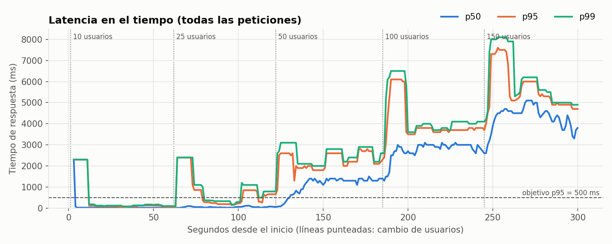

# Reporte de la prueba de carga · API de demanda (P1)

Generado el 2026-11-22 19:59 con `loadtest/generar_reporte.py` a partir de `reports/carga/locust_*.csv`.

## Escenario

Definido en [`loadtest/locustfile.py`](../../loadtest/locustfile.py): usuarios virtuales que piden pronósticos con una pausa de 0.5 a 1.5 s entre acciones. Mezcla de tareas: `POST /predict` (peso 10), `POST /predict/lote` con 24 estación-horas (peso 2), `GET /health` (peso 1) y una entrada inválida que debe responder 422 (peso 1, cuenta como éxito). La carga sube en escalones de usuarios; la API corre con los límites del `docker-compose.yml` (por defecto 1 CPU y 1 GB).

## Resultados globales

- Duración: 300 s · peticiones: 6,619 · fallas: 0 (0.00%)
- Throughput promedio: 22.1 peticiones/s · latencia p50 / p95 / p99: 1700 / 5000 / 6100 ms

| Endpoint | Peticiones | Fallas | Error % | Pet/s | Promedio ms | p50 ms | p95 ms | p99 ms | Máx ms |
|---|---|---|---|---|---|---|---|---|---|
| GET /health | 446 | 0 | 0.0 | 1.49 | 1917.6 | 1700 | 4900 | 6100 | 7294.0 |
| POST /predict | 4766 | 0 | 0.0 | 15.89 | 2081.2 | 1900 | 5000 | 6100 | 8215.0 |
| POST /predict (422 esperado) | 475 | 0 | 0.0 | 1.58 | 363.3 | 290 | 910 | 3200 | 4261.0 |
| POST /predict/lote | 932 | 0 | 0.0 | 3.11 | 2089.3 | 1900 | 5000 | 6700 | 8152.0 |
| **Total** | 6619 | 0 | 0.0 | 22.07 | 1948.1 | 1700 | 5000 | 6100 | 8215.0 |

## Por escalón de usuarios

Métricas de los segundos estables de cada escalón (sin las rampas). La latencia es la mediana de los percentiles móviles que Locust reporta cada segundo.

| usuarios | duracion_s | peticiones | rps | error_pct | p50_ms | p95_ms | p99_ms |
|---|---|---|---|---|---|---|---|
| 10 | 57 | 545 | 9.56 | 0.0 | 18.0 | 91.0 | 130.0 |
| 25 | 55 | 1236 | 22.47 | 0.0 | 50.0 | 610.0 | 790.0 |
| 50 | 56 | 1319 | 23.55 | 0.0 | 1300.0 | 2200.0 | 2750.0 |
| 100 | 53 | 1441 | 27.19 | 0.0 | 2900.0 | 3700.0 | 4000.0 |
| 150 | 53 | 1564 | 29.51 | 0.0 | 4500.0 | 5300.0 | 5600.0 |

### Observaciones

- **Capacidad sostenible:** 9.6 peticiones/s con 10 usuarios, p95 = 91 ms y 0.00% de error. Es el dato que usa el análisis FinOps.
- **Saturación:** a partir de 25 usuarios la p95 pasa de 91 ms a 610 ms (más del doble) mientras el throughput llega a 22.5 peticiones/s: la API está cerca de su límite de CPU.
- No hubo errores en ningún escalón.

## Gráficas

## Fallas

No se registraron fallas.

El reporte HTML interactivo de Locust está en [`locust.html`](locust.html).
